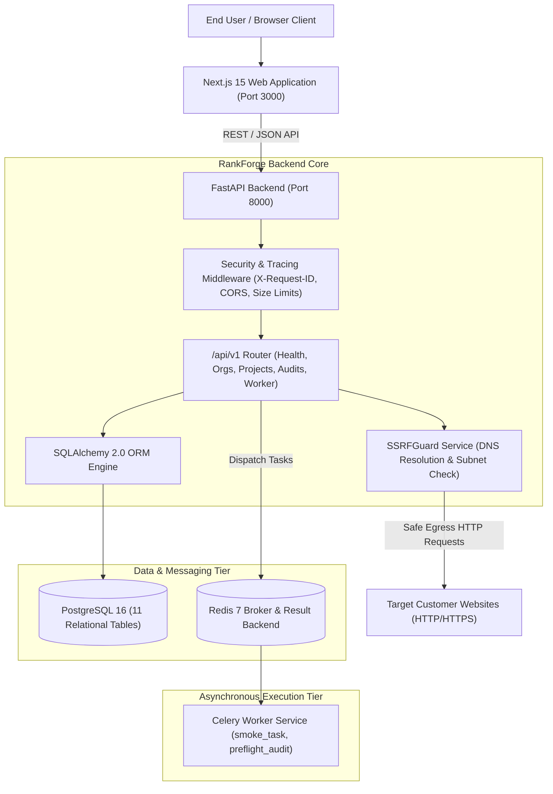

# RankForge AI — System Architecture Specification
**Document Version:** 1.0.0  
**Phase:** 1 (Application Foundation & Infrastructure)  
**Classification:** Technical Architecture  

---

## 1. Executive Summary & Platform Purpose
RankForge AI is a multi-tenant SEO intelligence, diagnostic, and automated website optimization SaaS platform. It enables enterprise marketing teams, agency consultants, and website operators to:
1. Perform continuous, deterministic technical SEO audits without generating fabricated or simulated results.
2. Ingest organic search performance and keyword metrics directly from Google Search Console.
3. Synthesize diagnostic data into actionable, prioritized optimization plans via an AI recommendation engine.
4. Safely deploy authorized auto-fixes through CMS and webhook integrations with comprehensive audit logs and single-click rollbacks.

Phase 1 provides the core foundation: monorepo workspace, enterprise design system, FastAPI backend API, PostgreSQL schema with 11 relational tables, Celery/Redis background worker queue, and Next.js 15 App Router frontend.

---

## 2. Architectural Principles
1. **Zero Decorative Fake Functionality:** No synthetic metrics, mock graphs disguised as live metrics, or simulated crawler activity.
2. **Strict Multi-Tenant Isolation:** All projects, audits, verifications, and event logs belong to an organization boundary with Row-Level Security (RLS) defense-in-depth.
3. **SSRF Defense-in-Depth:** Crawling and preflight engines must strictly reject RFC 1918 private subnets, loopbacks, and cloud metadata targets (`169.254.169.254`).
4. **Deterministic Auditing:** Real response times, true HTTP status codes, actual SSL evaluation, and genuine robots.txt / sitemap detection.
5. **Maintainable Modular Monorepo:** Clean separation across UI (`apps/web`), backend API (`apps/api`), asynchronous worker (`services/worker`), shared types (`packages/shared`), and infrastructure (`infrastructure/docker`).

---

## 3. High-Level System Architecture Diagram



---

## 4. Component Directory Topology
```
RANKFORGE/
├── apps/
│   ├── web/                     # Next.js App Router (TypeScript, Tailwind, Radix)
│   │   ├── app/                 # Public & Dashboard route trees
│   │   ├── components/          # UI primitives & Brand logomark
│   │   ├── lib/                 # Type-safe API client & utilities
│   │   └── tests/               # Vitest component test suite
│   └── api/                     # FastAPI backend
│       ├── app/
│       │   ├── api/v1/          # Endpoints: health, orgs, projects, audits, worker
│       │   ├── core/            # Config, logging, middleware, security
│       │   ├── db/              # SQLAlchemy session & declarative Base
│       │   ├── models/          # 11 relational database models
│       │   ├── schemas/         # Pydantic v2 request/response schemas
│       │   └── services/        # SSRFGuard, AuditService, ProjectService
│       ├── migrations/          # Alembic migrations & script templates
│       └── tests/               # Pytest suite with in-memory SQLite isolation
├── services/
│   └── worker/                  # Celery worker application
│       ├── celery_app.py        # Celery broker & result configuration
│       └── tasks/               # Harmless smoke task & health heartbeat
├── packages/
│   └── shared/                  # Universal TypeScript types, tokens, and schemas
├── infrastructure/
│   └── docker/                  # Multi-stage Dockerfiles for API, Worker, Web
├── docs/                        # Complete technical specifications & runbooks
├── scripts/                     # Local test and verification automation
├── docker-compose.yml           # Full container orchestration
└── README.md                    # Quickstart & onboarding guide
```

---

## 5. Network & Ingress Security
- **Cross-Origin Resource Sharing (CORS):** Strict allowlist configured in `apps/api/app/core/config.py`. Exposes tracing headers (`X-Request-ID`, `X-Process-Time-Ms`).
- **Request Size Safeguards:** Hard limit of 2MB on inbound request payloads to prevent memory exhaustion.
- **Structured Error Obfuscation:** Global exception handlers log complete stack traces internally with unique request IDs while returning sanitized JSON responses to clients.
- **SSRF Prevention:** Enforced via `SSRFGuard` prior to any socket connection or HTTP request execution.
