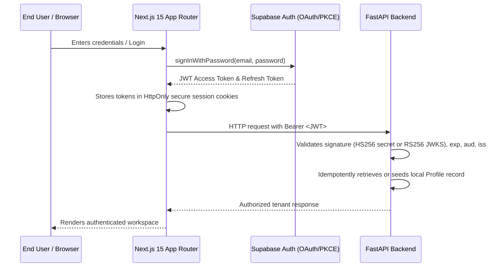

# RankForge AI — Authentication Architecture

## 1. Overview
RankForge AI uses a decoupled, defense-in-depth authentication model leveraging **Supabase Auth** on the frontend client with modern cookie-based session persistence, and strict cryptographic token signature verification on the FastAPI backend.

## 2. Next.js 15 Cookie Session Management (`@supabase/ssr`)
- **Browser Client (`apps/web/lib/supabase/client.ts`)**: Initializes standard `createBrowserClient` with public URL and anon key.
- **Server Client (`apps/web/lib/supabase/server.ts`)**: Uses `createServerClient` paired with Next.js 15 `cookies()` to safely read and persist cookie states inside Server Components, Route Handlers, and Server Actions.
- **Session Refresh Middleware (`apps/web/middleware.ts`)**: Runs on Edge runtime. Automatically refreshes expired tokens, synchronizes updated tokens to response cookies, and guards all `/dashboard/*` and `/onboarding` paths from unauthorized access.

## 3. FastAPI Cryptographic Verification (`app/core/security.py`)
The backend never trusts client assertions or blindly decodes token payloads.
- **Signature Verification**: Validates the cryptographic signature using HMAC-SHA256 (`SUPABASE_JWT_SECRET`) or asymmetric keys via the Supabase JWKS endpoint (`/.well-known/jwks.json`) with in-memory caching and automatic rotation.
- **Claim Enforcement**: Enforces `exp` (token expiration), `aud` (must match `authenticated`), and valid `sub` (UUID mapped to `profiles.id`).
- **Profile Synchronization**: Upon successful cryptographic validation, `get_current_user` extracts identity claims and verifies or seeds the user's `Profile` record idempotently in the local PostgreSQL database.
- **Local Dev / Testing Bypass**: Isolated development token protocol (`dev_token_<user_id>::<email>`) enabled specifically for automated unit testing and offline development without external network dependencies.

## 4. Auth Routes & Screens
1. `/login`: Email + password authentication, show/hide eye toggle, remember me checkbox, error banner, and dev demo login shortcut.
2. `/register`: Multi-tenant registration, full name, work email, password strength meter, terms acceptance checkbox.
3. `/verify-email`: Informative confirmation view with email display and resend link functionality.
4. `/forgot-password`: Account recovery email request with generic anti-enumeration confirmation.
5. `/reset-password`: Form to submit and verify new account password.
6. `/auth/callback`: PKCE authorization code exchange endpoint redirecting to destination dashboard.
