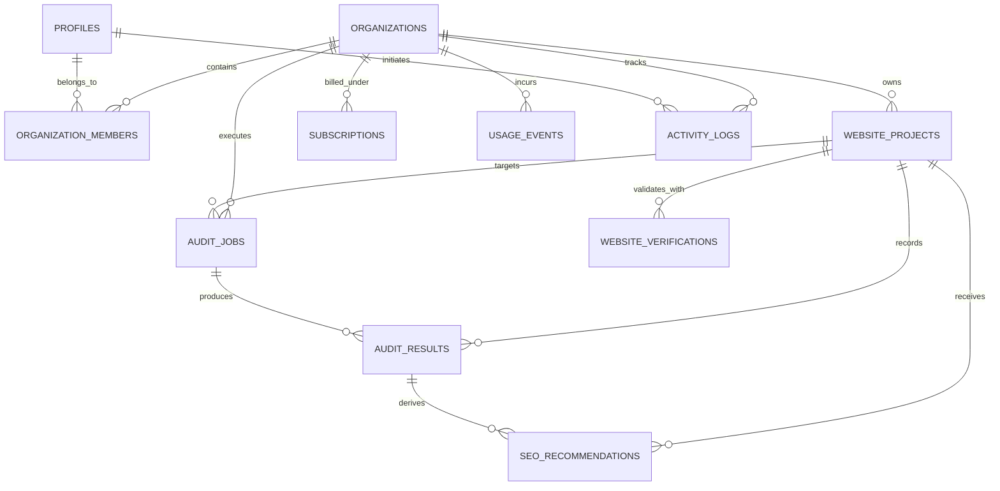

# RankForge AI — Database Schema & Multi-Tenant Isolation
**Document Version:** 1.0.0  
**Phase:** 1  
**Target Engine:** PostgreSQL 16 (Supabase Compatible)  

---

## 1. Relational Entity-Relationship Diagram



---

## 2. Table Specifications (11 Foundational Tables)

### 2.1 `profiles`
Maps user identities (internal or Supabase Auth `auth.users`).
- `id` (VARCHAR(36), PK): UUID.
- `email` (VARCHAR(255), UNIQUE, INDEX): Work email address.
- `full_name` (VARCHAR(255)): Display name.
- `avatar_url` (VARCHAR(1024)): Optional profile image.
- `role` (VARCHAR(50)): Global role (`owner`, `admin`, `member`).
- `created_at`, `updated_at` (TIMESTAMPTZ).

### 2.2 `organizations`
Tenant isolation boundary. All resources are scoped to an organization.
- `id` (VARCHAR(36), PK): UUID.
- `name` (VARCHAR(255)): Organization / company name.
- `slug` (VARCHAR(100), UNIQUE, INDEX): URL-friendly slug.
- `plan_tier` (VARCHAR(50)): `starter`, `professional`, `agency`.
- `created_at`, `updated_at` (TIMESTAMPTZ).

### 2.3 `organization_members`
Links profiles to organizations with role-based access.
- `id` (VARCHAR(36), PK): UUID.
- `organization_id` (VARCHAR(36), FK -> `organizations.id` ON DELETE CASCADE).
- `user_id` (VARCHAR(36), FK -> `profiles.id` ON DELETE CASCADE).
- `role` (VARCHAR(50)): `owner`, `admin`, `member`.
- `created_at`, `updated_at` (TIMESTAMPTZ).
- **Constraint:** `UNIQUE(organization_id, user_id)`.

### 2.4 `website_projects`
Websites monitored and optimized under an organization.
- `id` (VARCHAR(36), PK): UUID.
- `organization_id` (VARCHAR(36), FK -> `organizations.id` ON DELETE CASCADE).
- `name` (VARCHAR(255)): Project label.
- `domain` (VARCHAR(255), INDEX): Normalized domain (e.g., `example.com`).
- `primary_url` (VARCHAR(1024)): Target URL (e.g., `https://example.com`).
- `is_verified` (BOOLEAN): Ownership confirmation status.
- `verification_token` (VARCHAR(128)): Unique verification token string.
- `created_at`, `updated_at` (TIMESTAMPTZ).
- **Constraint:** `UNIQUE(organization_id, domain)`.

### 2.5 `website_verifications`
Ownership validation audit log for DNS TXT, HTML tag, and file upload.
- `id` (VARCHAR(36), PK): UUID.
- `project_id` (VARCHAR(36), FK -> `website_projects.id` ON DELETE CASCADE).
- `method` (VARCHAR(50)): `dns_txt`, `meta_tag`, `file_upload`.
- `token` (VARCHAR(128)): Expected verification payload.
- `status` (VARCHAR(50)): `pending`, `verified`, `failed`.
- `verified_at` (TIMESTAMPTZ, NULLABLE).
- `created_at`, `updated_at` (TIMESTAMPTZ).

### 2.6 `audit_jobs`
Asynchronous background execution runs.
- `id` (VARCHAR(36), PK): UUID.
- `project_id` (VARCHAR(36), FK -> `website_projects.id` ON DELETE CASCADE).
- `organization_id` (VARCHAR(36), FK -> `organizations.id` ON DELETE CASCADE).
- `job_type` (VARCHAR(50)): `preflight`, `technical_crawl`.
- `status` (VARCHAR(50), INDEX): `pending`, `running`, `completed`, `failed`.
- `celery_task_id` (VARCHAR(128), NULLABLE).
- `started_at`, `completed_at` (TIMESTAMPTZ, NULLABLE).
- `error_message` (VARCHAR(1024), NULLABLE).
- `created_at`, `updated_at` (TIMESTAMPTZ).

### 2.7 `audit_results`
Detailed findings from an executed audit run.
- `id` (VARCHAR(36), PK): UUID.
- `job_id` (VARCHAR(36), FK -> `audit_jobs.id` ON DELETE CASCADE).
- `project_id` (VARCHAR(36), FK -> `website_projects.id` ON DELETE CASCADE).
- `url` (VARCHAR(1024)): Inspected URL.
- `status_code` (INTEGER): HTTP response status.
- `response_time_ms` (FLOAT): Latency to first byte.
- `headers_json` (JSON): Captured response headers.
- `ssl_info_json` (JSON): SSL certificate validity and protocol.
- `robots_txt_found` (BOOLEAN): Presence of valid robots.txt.
- `sitemap_found` (BOOLEAN): Presence of root sitemap.xml.
- `issues_json` (JSON): Array of categorized diagnostic findings.
- `score` (INTEGER): Deterministic score (0-100).
- `created_at`, `updated_at` (TIMESTAMPTZ).

### 2.8 `seo_recommendations`
Actionable SEO recommendations identified from audit findings.
- `id` (VARCHAR(36), PK): UUID.
- `project_id` (VARCHAR(36), FK -> `website_projects.id` ON DELETE CASCADE).
- `audit_result_id` (VARCHAR(36), FK -> `audit_results.id` ON DELETE SET NULL, NULLABLE).
- `category` (VARCHAR(50)): `technical`, `performance`, `content`, `indexing`.
- `severity` (VARCHAR(50)): `critical`, `warning`, `info`.
- `title` (VARCHAR(255)): Recommendation summary.
- `description` (TEXT): Diagnostic rationale.
- `suggested_fix` (TEXT, NULLABLE): Specific schema or code patch.
- `status` (VARCHAR(50)): `open`, `approved`, `applied`, `dismissed`.
- `created_at`, `updated_at` (TIMESTAMPTZ).

### 2.9 `subscriptions`
Billing state and Stripe customer identifiers.
- `id` (VARCHAR(36), PK): UUID.
- `organization_id` (VARCHAR(36), FK -> `organizations.id` ON DELETE CASCADE, UNIQUE).
- `stripe_customer_id` (VARCHAR(128), NULLABLE).
- `stripe_subscription_id` (VARCHAR(128), NULLABLE).
- `plan` (VARCHAR(50)): `starter`, `professional`, `agency`.
- `status` (VARCHAR(50)): `active`, `past_due`, `canceled`.
- `current_period_end` (TIMESTAMPTZ, NULLABLE).
- `created_at`, `updated_at` (TIMESTAMPTZ).

### 2.10 `usage_events`
Metered usage tracking for quota enforcement.
- `id` (VARCHAR(36), PK): UUID.
- `organization_id` (VARCHAR(36), FK -> `organizations.id` ON DELETE CASCADE).
- `event_type` (VARCHAR(100), INDEX): e.g., `audit_crawl`, `api_call`.
- `count` (INTEGER): Quantity of units.
- `metadata_json` (JSON): Event context.
- `created_at`, `updated_at` (TIMESTAMPTZ).

### 2.11 `activity_logs`
Immutable audit log for multi-tenant actions.
- `id` (VARCHAR(36), PK): UUID.
- `organization_id` (VARCHAR(36), FK -> `organizations.id` ON DELETE CASCADE).
- `user_id` (VARCHAR(36), FK -> `profiles.id` ON DELETE SET NULL, NULLABLE).
- `action` (VARCHAR(100), INDEX): e.g., `project_created`, `audit_executed`.
- `entity_type` (VARCHAR(100)): e.g., `website_project`.
- `entity_id` (VARCHAR(36), NULLABLE).
- `details_json` (JSON): Snapshot of modified fields.
- `created_at`, `updated_at` (TIMESTAMPTZ).

---

## 3. Row-Level Security (RLS) Policy Specifications
In Supabase/PostgreSQL production environments, RLS is enabled on all tables:

```sql
-- Enable RLS on core tables
ALTER TABLE organizations ENABLE ROW LEVEL SECURITY;
ALTER TABLE website_projects ENABLE ROW LEVEL SECURITY;
ALTER TABLE audit_jobs ENABLE ROW LEVEL SECURITY;
ALTER TABLE audit_results ENABLE ROW LEVEL SECURITY;

-- Organization membership isolation helper
CREATE OR REPLACE FUNCTION user_has_org_access(target_org_id VARCHAR)
RETURNS BOOLEAN AS $$
BEGIN
    RETURN EXISTS (
        SELECT 1 FROM organization_members
        WHERE organization_id = target_org_id
        AND user_id = auth.uid()::VARCHAR
    );
END;
$$ LANGUAGE plpgsql SECURITY DEFINER;

-- Website Projects Policy
CREATE POLICY "Users can only read website projects of their organization"
ON website_projects FOR SELECT
USING (user_has_org_access(organization_id));

CREATE POLICY "Users can only insert website projects into their organization"
ON website_projects FOR INSERT
WITH CHECK (user_has_org_access(organization_id));

-- Audit Jobs Policy
CREATE POLICY "Users can only view audit jobs of their organization"
ON audit_jobs FOR SELECT
USING (user_has_org_access(organization_id));
```
