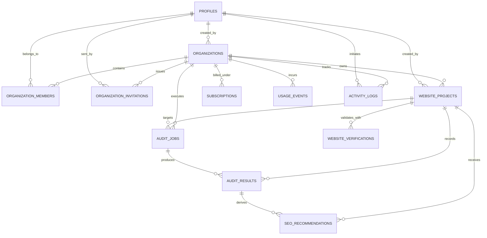

# RankForge AI — Database Schema & Multi-Tenant Isolation
**Document Version:** 2.0.0  
**Phase:** 2 (Authentication, Organization Workspaces & Website Management)  
**Target Engine:** PostgreSQL 16 (Supabase Compatible)  

---

## 1. Relational Entity-Relationship Diagram

---

## 2. Table Specifications (Phase 2 Master Schema)

### 2.1 `profiles`
Maps user identities (linked 1:1 with Supabase Auth `auth.users`).
- `id` (VARCHAR(36), PK): UUID.
- `email` (VARCHAR(255), UNIQUE, INDEX): Work email address.
- `full_name` (VARCHAR(255)): Official user name.
- `display_name` (VARCHAR(255)): User chosen display alias. *(Added in Phase 2)*
- `avatar_url` (VARCHAR(1024)): Optional profile avatar image.
- `role` (VARCHAR(50)): Platform level role (`member`).
- `created_at`, `updated_at` (TIMESTAMPTZ).

### 2.2 `organizations`
Tenant isolation boundary. All resources are strictly scoped to an organization.
- `id` (VARCHAR(36), PK): UUID.
- `name` (VARCHAR(255)): Organization / Agency workspace name.
- `slug` (VARCHAR(100), UNIQUE, INDEX): URL-friendly slug.
- `plan_tier` (VARCHAR(50)): `starter`, `professional`, `agency`, `enterprise`.
- `created_by` (VARCHAR(36), FK -> `profiles.id` ON DELETE SET NULL). *(Added in Phase 2)*
- `created_at`, `updated_at` (TIMESTAMPTZ).

### 2.3 `organization_members`
Links profiles to organizations with role-based access.
- `id` (VARCHAR(36), PK): UUID.
- `organization_id` (VARCHAR(36), FK -> `organizations.id` ON DELETE CASCADE, INDEX).
- `user_id` (VARCHAR(36), FK -> `profiles.id` ON DELETE CASCADE, INDEX).
- `role` (VARCHAR(50)): `owner`, `admin`, `editor`, `viewer`. *(Phase 2 4-tier RBAC)*
- `invited_by` (VARCHAR(36), FK -> `profiles.id` ON DELETE SET NULL). *(Added in Phase 2)*
- `created_at`, `updated_at` (TIMESTAMPTZ).
- **Constraint:** `UNIQUE(organization_id, user_id)`.

### 2.4 `organization_invitations` *(New in Phase 2)*
Manages workspace team invitations using cryptographically secure tokens.
- `id` (VARCHAR(36), PK): UUID.
- `organization_id` (VARCHAR(36), FK -> `organizations.id` ON DELETE CASCADE, INDEX).
- `invited_email` (VARCHAR(255), INDEX): Email of invited user.
- `invited_role` (VARCHAR(50)): `admin`, `editor`, `viewer`.
- `invited_by` (VARCHAR(36), FK -> `profiles.id` ON DELETE CASCADE): Inviting user.
- `token_hash` (VARCHAR(64), UNIQUE, INDEX): SHA-256 hash of single-use URL token.
- `expires_at` (TIMESTAMPTZ): Invitation expiry timestamp (default 7 days).
- `accepted_at` (TIMESTAMPTZ, NULLABLE): Acceptance timestamp.
- `revoked_at` (TIMESTAMPTZ, NULLABLE): Revocation timestamp.
- `created_at`, `updated_at` (TIMESTAMPTZ).

### 2.5 `website_projects`
Websites monitored under an organization workspace.
- `id` (VARCHAR(36), PK): UUID.
- `organization_id` (VARCHAR(36), FK -> `organizations.id` ON DELETE CASCADE, INDEX).
- `name` (VARCHAR(255)): Display name.
- `domain` (VARCHAR(255), INDEX): Normalized domain name.
- `primary_url` (VARCHAR(1024)): Canonical starting URL with scheme.
- `description` (TEXT, NULLABLE): Project notes. *(Added in Phase 2)*
- `is_verified` (BOOLEAN, DEFAULT FALSE): Ownership verification state.
- `verification_status` (VARCHAR(50), DEFAULT 'pending'): `pending`, `verified`, `failed`. *(Added in Phase 2)*
- `verification_token` (VARCHAR(128)): Cryptographic token for DNS/Meta/File validation.
- `created_by` (VARCHAR(36), FK -> `profiles.id` ON DELETE SET NULL). *(Added in Phase 2)*
- `archived_at` (TIMESTAMPTZ, NULLABLE): Soft-delete archive timestamp. *(Added in Phase 2)*
- `created_at`, `updated_at` (TIMESTAMPTZ).
- **Constraint:** `UNIQUE(organization_id, domain)`.

---

## 3. Database Migrations (Alembic)
1. `001_initial_schema`: Base PostgreSQL tables (profiles, organizations, members, websites, verifications, audits, jobs, subscriptions, activity logs).
2. `002_phase_2_auth_workspaces`:
   - Adds `display_name` to `profiles`.
   - Adds `created_by` to `organizations`.
   - Adds `invited_by` to `organization_members`.
   - Creates `organization_invitations` table with SHA-256 token hashing.
   - Adds `description`, `created_by`, `verification_status`, and `archived_at` to `website_projects`.
