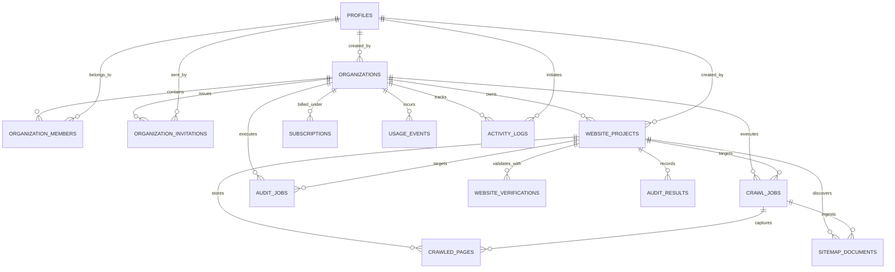

# RankForge AI — Database Schema & Multi-Tenant Isolation
**Document Version:** 3.0.0  
**Phase:** 3 (Domain Verification & Intelligent Website Crawler)  
**Target Engine:** PostgreSQL 16 (Supabase Compatible)  

---

## 1. Relational Entity-Relationship Diagram

---

## 2. Table Specifications (Phase 3 Master Schema)

### 2.1 `website_verifications` *(Enhanced in Phase 3)*
Manages domain ownership challenge records and real-time validation tracking.
- `id` (VARCHAR(36), PK): UUID.
- `project_id` (VARCHAR(36), FK -> `website_projects.id` ON DELETE CASCADE, INDEX).
- `method` (VARCHAR(50)): `dns_txt`, `file_upload`.
- `token` (VARCHAR(128)): Cryptographic nonce (32 hex characters).
- `status` (VARCHAR(50), DEFAULT 'pending', INDEX): `pending`, `verified`, `failed`, `revoked`, `expired`.
- `txt_record_name` (VARCHAR(255), NULLABLE): e.g. `_rankforge-challenge.<domain>`. *(Phase 3)*
- `txt_record_value` (VARCHAR(255), NULLABLE): e.g. `rankforge-verification=<token>`. *(Phase 3)*
- `file_path` (VARCHAR(255), NULLABLE): e.g. `/.well-known/rankforge-verification.txt`. *(Phase 3)*
- `file_content` (TEXT, NULLABLE): Expected content for verification file. *(Phase 3)*
- `last_checked_at` (TIMESTAMPTZ, NULLABLE): Timestamp of most recent verification check. *(Phase 3)*
- `failure_reason` (VARCHAR(1024), NULLABLE): Explanatory error details if check failed. *(Phase 3)*
- `expires_at` (TIMESTAMPTZ, NULLABLE): 7-day token expiration threshold. *(Phase 3)*
- `verified_at` (TIMESTAMPTZ, NULLABLE): Timestamp when verification succeeded. *(Phase 3)*
- `revoked_at` (TIMESTAMPTZ, NULLABLE): Timestamp when verification was revoked. *(Phase 3)*
- `created_at`, `updated_at` (TIMESTAMPTZ).

### 2.2 `crawl_jobs` *(New in Phase 3)*
Asynchronous website crawler execution record managing progress, metrics, and lifecycle.
- `id` (VARCHAR(36), PK): UUID.
- `project_id` (VARCHAR(36), FK -> `website_projects.id` ON DELETE CASCADE, INDEX).
- `organization_id` (VARCHAR(36), FK -> `organizations.id` ON DELETE CASCADE, INDEX).
- `status` (VARCHAR(50), DEFAULT 'queued', INDEX): `queued`, `running`, `completed`, `partially_completed`, `failed`, `cancelled`.
- `celery_task_id` (VARCHAR(128), NULLABLE): Task identifier for Celery worker.
- `max_pages` (INTEGER, DEFAULT 50): Maximum pages budget.
- `max_depth` (INTEGER, DEFAULT 3): Maximum BFS depth limit.
- `pages_crawled` (INTEGER, DEFAULT 0): Number of successfully fetched pages.
- `pages_discovered` (INTEGER, DEFAULT 0): Number of unique URLs discovered.
- `pages_failed` (INTEGER, DEFAULT 0): Number of failed fetches (non-200, timeout, error).
- `pages_blocked` (INTEGER, DEFAULT 0): Number of pages disallowed by robots.txt.
- `started_at` (TIMESTAMPTZ, NULLABLE): Timestamp when crawl started.
- `completed_at` (TIMESTAMPTZ, NULLABLE): Timestamp when crawl ended.
- `error_message` (VARCHAR(1024), NULLABLE): Failure or abort message.
- `config_json` (JSON, DEFAULT '{}'): Runtime parameters snapshot.
- `created_at`, `updated_at` (TIMESTAMPTZ).

### 2.3 `crawled_pages` *(New in Phase 3)*
Extracted structural inventory and technical SEO metadata captured per crawled page.
- `id` (VARCHAR(36), PK): UUID.
- `job_id` (VARCHAR(36), FK -> `crawl_jobs.id` ON DELETE CASCADE, INDEX).
- `project_id` (VARCHAR(36), FK -> `website_projects.id` ON DELETE CASCADE, INDEX).
- `url` (VARCHAR(1024), INDEX): Original requested URL.
- `normalized_url` (VARCHAR(1024), INDEX): Canonicalized URL.
- `status_code` (INTEGER, DEFAULT 0): HTTP response status code.
- `response_time_ms` (FLOAT, DEFAULT 0.0): Latency in milliseconds.
- `content_type` (VARCHAR(255), NULLABLE): HTTP Content-Type header.
- `byte_size` (INTEGER, DEFAULT 0): Downloaded payload size in bytes.
- `depth` (INTEGER, DEFAULT 0): Traversal depth level from seed.
- `discovery_method` (VARCHAR(50), DEFAULT 'hyperlink'): `seed`, `sitemap`, `hyperlink`.
- `title` (VARCHAR(512), NULLABLE): Document `<title>` text.
- `meta_description` (TEXT, NULLABLE): `<meta name="description">` content.
- `canonical_url` (VARCHAR(1024), NULLABLE): `<link rel="canonical">` target.
- `meta_robots` (VARCHAR(255), NULLABLE): `<meta name="robots">` directive string.
- `h1_count` (INTEGER, DEFAULT 0): Total `<h1>` tags on page.
- `internal_links_count` (INTEGER, DEFAULT 0): Count of internal in-scope hyperlinks.
- `external_links_count` (INTEGER, DEFAULT 0): Count of external out-of-scope hyperlinks.
- `links_json` (JSON, DEFAULT '[]'): List of discovered outbound links with anchor text and rel attributes.
- `content_hash` (VARCHAR(64), NULLABLE): SHA-256 fingerprint of response body.
- `error_details` (VARCHAR(1024), NULLABLE): Fetch error or robots blocked reason.
- `created_at`, `updated_at` (TIMESTAMPTZ).

### 2.4 `sitemap_documents` *(New in Phase 3)*
Discovered and parsed XML sitemaps captured during crawl execution.
- `id` (VARCHAR(36), PK): UUID.
- `project_id` (VARCHAR(36), FK -> `website_projects.id` ON DELETE CASCADE, INDEX).
- `job_id` (VARCHAR(36), FK -> `crawl_jobs.id` ON DELETE CASCADE, INDEX).
- `url` (VARCHAR(1024)): Sitemap URL.
- `discovery_source` (VARCHAR(50), DEFAULT 'robots'): `robots`, `well_known`, `index`.
- `status_code` (INTEGER, DEFAULT 0): HTTP response status code.
- `status` (VARCHAR(50), DEFAULT 'discovered'): `discovered`, `parsed`, `failed`.
- `urls_found` (INTEGER, DEFAULT 0): Count of page URLs extracted.
- `error_details` (VARCHAR(1024), NULLABLE): Error details if XML parsing failed.
- `created_at`, `updated_at` (TIMESTAMPTZ).

---

## 3. Database Migrations (Alembic)
1. `001_initial_schema`: Base PostgreSQL tables (profiles, organizations, members, websites, verifications, audits, jobs, subscriptions, activity logs).
2. `002_phase_2_auth_workspaces`: Multi-tenant organization workspaces, RBAC, invitations, and website project management.
3. `003_phase_3_crawler`: Domain ownership verification columns, `crawl_jobs`, `crawled_pages`, and `sitemap_documents` tables.
