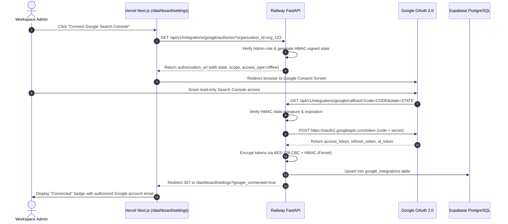

# RankForge AI — Google Search Console OAuth2 Deployment Guide

## 1. Overview & Security Model

RankForge AI connects to Google Search Console to ingest organic search impressions, query rankings, and CTR data for verified website projects.

### Core Security Guarantees
1. **Read-Only Scopes:** RankForge AI strictly requests read-only Search Console access (`https://www.googleapis.com/auth/webmasters.readonly`). It CANNOT make changes, submit disavow files, or alter site ownership in Google Search Console.
2. **Server-Side Token Exchange:** The Google client secret (`GOOGLE_CLIENT_SECRET`) is stored ONLY on the Railway API container. It is NEVER exposed to the Vercel frontend or client browsers.
3. **Encrypted Token Storage:** Stored access tokens and refresh tokens are encrypted at rest using AES-128-CBC + HMAC (Fernet) derived from `SECRET_KEY`.
4. **Tamper-Proof State Parameter:** OAuth state parameters are HMAC-signed with SHA-256 and expire within 15 minutes to prevent CSRF and replay attacks.
5. **Multi-Tenant RBAC:** Only Workspace Admins and Owners can initiate Google OAuth connections for an organization.

---

## 2. Google Cloud Console Setup Instructions

### Step 1: Create or Select Google Cloud Project
1. Navigate to the [Google Cloud Console](https://console.cloud.google.com/).
2. Create a new project named `RankForge AI` (or select your existing project).

### Step 2: Enable Google Search Console API
1. In the navigation menu, go to **APIs & Services** -> **Library**.
2. Search for **Google Search Console API** (Webmasters API).
3. Click **Enable**.

### Step 3: Configure OAuth Consent Screen
1. Go to **APIs & Services** -> **OAuth consent screen**.
2. Choose **External** user type and click **Create**.
3. **App Information:**
   - App name: `RankForge AI`
   - User support email: Your support email (e.g., `support@rankforge.ai`)
   - Developer contact email: Your admin email
4. **Authorized Domains:**
   - Add `rankforge.ai`
   - Add `vercel.app`
5. **Scopes:**
   - Click **Add or Remove Scopes**.
   - Select:
     - `.../auth/userinfo.email`
     - `.../auth/userinfo.profile`
     - `openid`
     - `https://www.googleapis.com/auth/webmasters.readonly`
6. Save and continue.

---

## 3. Configure OAuth 2.0 Client Credentials

1. In the Google Cloud Console, navigate to **APIs & Services** -> **Credentials**.
2. Click **+ Create Credentials** -> **OAuth client ID**.
3. Set **Application type** to `Web application`.
4. Set **Name** to `RankForge AI Production Web Client`.

### Authorized JavaScript Origins
Add both your production frontend domains and local dev URLs:
```
https://rankforge.ai
https://rankforge.vercel.app
http://localhost:3000
```

### Authorized Redirect URIs
Add the exact FastAPI callback path on your production API and development servers:
```
https://api.rankforge.ai/api/v1/integrations/google/callback
https://rankforge-api-production.up.railway.app/api/v1/integrations/google/callback
http://localhost:8000/api/v1/integrations/google/callback
```

> [!IMPORTANT]
> **Exact Callback Path:**
> `/api/v1/integrations/google/callback`
> If the registered redirect URI in Google Cloud Console does not match the incoming request origin byte-for-byte, Google returns an `invalid_grant` or `redirect_uri_mismatch` error.

---

## 4. Railway Backend Environment Variables

Once generated, copy the client credentials into your Railway API environment variables:

| Variable | Description |
| :--- | :--- |
| `GOOGLE_CLIENT_ID` | OAuth 2.0 Client ID (e.g., `123456789-abc.apps.googleusercontent.com`) |
| `GOOGLE_CLIENT_SECRET` | OAuth 2.0 Client Secret (e.g., `GOCSPX-abc123xyz456`) |
| `GOOGLE_REDIRECT_URI` | *(Optional override)* Defaults to `${PUBLIC_API_URL}/api/v1/integrations/google/callback` |
| `PUBLIC_API_URL` | Base HTTPS URL of your Railway API (e.g., `https://api.rankforge.ai`) |
| `FRONTEND_URL` | Base HTTPS URL of your Vercel frontend (e.g., `https://rankforge.ai`) |

---

## 5. End-to-End Authorization Workflow



---

## 6. Token Lifecycle & Automated Refresh

- **Access Token Lifetime:** 3,600 seconds (1 hour).
- **Refresh Token:** Long-lived credential provided when `access_type=offline` and `prompt=consent` are specified.
- **Automated Refresh:** `app.services.google_oauth.refresh_access_token(refresh_token)` requests a fresh access token from `https://oauth2.googleapis.com/token` whenever the current token is near expiration.
