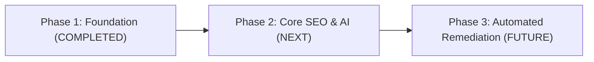

# RankForge AI — Product Roadmap & Phase Boundaries
**Document Version:** 1.0.0  
**Status:** Phase 1 Complete / Phase 2 Ready  

---

## 1. Phase Governance & Execution Strategy

---

## 2. Phase 1: SaaS Foundation & Infrastructure (Completed)
- [x] Monorepo workspace (`apps/web`, `apps/api`, `services/worker`, `packages/shared`, `infrastructure/docker`).
- [x] Enterprise dark-first design system with restrained crimson accents and tabular numerals.
- [x] Abstract SVG geometric brand logomark.
- [x] FastAPI core backend with `/health/live`, `/health/ready`, and structured JSON logging.
- [x] PostgreSQL 16 schema with 11 relational tables and Alembic migrations.
- [x] Multi-tenant boundary isolation and documented Row-Level Security (RLS) policies.
- [x] Redis 7 and Celery worker background queue with tested smoke task.
- [x] Server-Side Request Forgery (SSRF) defense engine blocking private subnets and metadata IPs.
- [x] Next.js 15 App Router web application with complete 12-page responsive shell.
- [x] Safe, deterministic preflight website auditing (HTTP status, latency, SSL, robots.txt, sitemap).
- [x] Domain ownership verification workflows (DNS TXT, meta tag, file upload).
- [x] Automated test suites: Pytest backend (17 tests), Vitest frontend (7 tests), Playwright smoke tests.
- [x] Docker Compose local development and CI quality gate.

---

## 3. Phase 2: Core SEO Intelligence & AI Recommendations (Next Phase)
- **Supabase Authentication:** Replace dev-mode auth bypass with production Supabase Auth JWT cookies, user session management, and OAuth providers (Google, GitHub).
- **Google Search Console Integration:** OAuth2 connection flow allowing users to authorize properties and schedule daily query, impression, and click data syncing.
- **Deep Technical Crawler:** Recursive asynchronous crawler discovering sitemaps, canonical loops, broken internal links, and Core Web Vitals.
- **AI Recommendation Engine:** Structured prompt pipeline evaluating deterministic audit findings against schema.org and modern SEO best practices.
- **Stripe Subscription Billing:** Checkout sessions, customer portal, and webhook listener updating `subscriptions` table.
- **Automated PDF Reports:** Headless Chromium service rendering executive white-label audit reports.

---

## 4. Phase 3: Automated Remediation & Agency Collaboration (Future)
- **Authorized CMS Connectors:** WordPress plugin, Shopify app, and Next.js edge middleware for deploying approved meta tags, canonicals, and redirects.
- **Single-Click Rollback:** Immutable version history enabling instant reversal of any deployed modification.
- **Multi-Brand Agency Workspaces:** Client sub-accounts with custom permission tiers and white-label client portals.
- **Scheduled Automated Crawl Alerts:** Webhook and email alerts for indexation drops or broken links.
