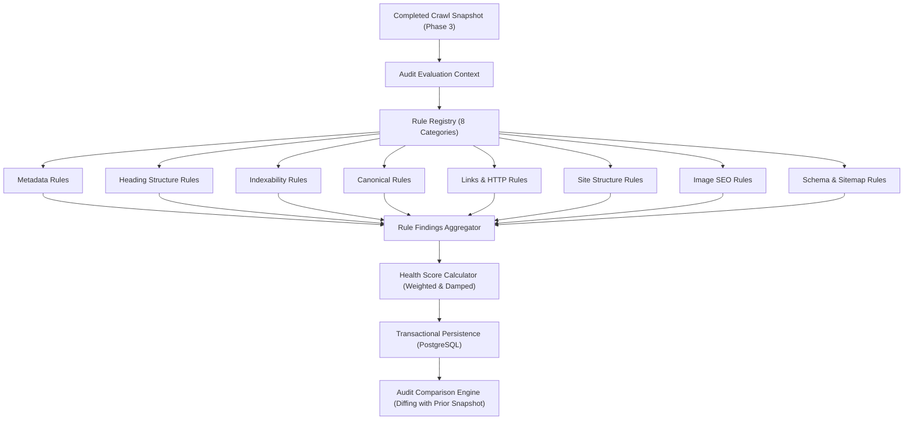

# Technical SEO Audit Engine Architecture

## 1. Overview & Core Philosophy

RankForge AI's Technical SEO Audit Engine (Phase 4) is designed around strict principles of determinism, explainability, and multi-tenant security:

1. **Zero Fabricated Metrics:** The audit engine operates exclusively on genuine data extracted during crawler executions. It never synthesizes fake scores or simulated progress.
2. **Decoupled Architecture:** Crawling (data acquisition) and Auditing (rule evaluation) are completely decoupled. The audit engine receives a completed `crawl_job_id` and analyzes stored snapshots from the database without re-fetching network resources.
3. **Idempotence & Snapshot Re-analysis:** Completed crawl snapshots can be re-audited at any time with updated or custom rulesets without triggering redundant network requests.
4. **Tenant Isolation:** All audit runs, findings, category scores, and comparisons are strictly partitioned by `organization_id`.

---

## 2. Asynchronous & Synchronous Execution Lifecycle

Audits are orchestrated via `SEOAuditOrchestrator` (`apps/api/app/services/audit/audit_orchestrator.py`):

1. **Trigger Request (`POST /api/v1/organizations/{org_id}/websites/{website_id}/audits`):**
   - Enforces the **Website Ownership Verification Gate**: Only verified websites can be audited.
   - Resolves target crawl job: defaults to the latest completed crawl job snapshot.
   - Instantiates `SEOAuditRun` in `"queued"` state.
   - If `execute_sync=true`: Runs inline for automated testing or rapid interactive checks.
   - If asynchronous: Dispatches `tasks.audit.execute_audit` via Celery & Redis.

2. **Evaluation Pipeline:**
   - Marks audit as `"running"` and updates `started_at`.
   - Loads all `CrawledPage` items and `SitemapDocument` items for the target crawl job.
   - Builds `AuditEvaluationContext`, constructing internal link graphs (`inlinks_map` and `outlinks_map`).
   - Executes registered rules across all 8 technical SEO categories.
   - Invokes `AuditScoreCalculator` to compute category scores and overall health score.
   - Checks for task cancellation checkpoints before writing results.
   - Atomically persists `SEOAuditFinding` and `SEOAuditCategoryScore` records.
   - If a prior completed audit exists for this website, automatically triggers `AuditComparisonService`.
   - Sets audit status to `"completed"` (or `"insufficient_coverage"` if coverage threshold is unmet).

---

## 3. Audit Comparison Service

The comparison engine (`apps/api/app/services/audit/comparison_service.py`) calculates differential health across sequential audit runs:
- Utilizes deterministic SHA-256 fingerprints (`finding_fingerprint`) rather than mutable database primary keys.
- Categorizes findings into:
  - **New Issues:** Detected in current snapshot but absent in previous snapshot.
  - **Resolved Issues:** Present in previous snapshot but absent in current snapshot.
  - **Persisting Issues:** Present in both snapshots.
- Computes `score_change = current_score - previous_score`.
- Persists summary to `seo_audit_comparisons` table for historical delta tracking.
