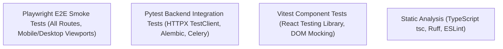

# RankForge AI — Test Strategy & Quality Assurance
**Document Version:** 1.0.0  
**Phase:** 1  

---

## 1. Testing Philosophy
RankForge AI enforces a deterministic, evidence-based quality gate. No code is committed or merged without passing automated checks. Tests run against real database instances (SQLite static pool in local tests, PostgreSQL in CI/staging) and genuine HTTP/worker logic.

---

## 2. Test Pyramid & Tooling Stack



---

## 3. Test Suites & Execution Instructions

### 3.1 Backend Pytest Suite
Verifies:
- Liveness probe (`/health/live`)
- Readiness probe with dependency diagnostics (`/health/ready`)
- Root branding endpoint (`/`)
- Organization creation and slug conflict rejection (`/api/v1/organizations`)
- Website project registration and verification instructions (`/api/v1/projects`)
- SSRF Guard validation against RFC 1918 private subnets, loopbacks, and cloud metadata
- Preflight audit execution with deterministic scoring and header inspection
- Celery worker smoke task calculation and ping heartbeat

**Command:**
```powershell
.\.venv\Scripts\pytest.exe apps/api/tests -v
```

### 3.2 Frontend Vitest Component Suite
Verifies:
- Brand Logo SVG geometry, sizing, and text visibility options
- Button variants (default crimson, secondary surface, ghost, danger, disabled states)
- FeatureGate coming-soon state rendering, architecture highlights, and dependency checklists

**Command:**
```powershell
npm run test --workspace=apps/web
```

### 3.3 TypeScript Typecheck & Production Build
Verifies:
- Strict mode TypeScript compilation across all models, components, and pages (`tsc --noEmit`)
- Next.js 15 static page generation across all 15 routes

**Commands:**
```powershell
npm run typecheck --workspace=apps/web
npm run build --workspace=apps/web
```

### 3.4 Playwright Browser Smoke Tests
Verifies:
- All 12 application routes render without console errors
- Responsive layout across desktop (1280x720) and mobile (Pixel 5) viewports
- Captures browser screenshots for critical visual review

**Command:**
```powershell
npx playwright test
```

---

## 4. Regression Policy
In accordance with Rule 14, every future release phase must re-run:
1. All Phase 1 backend unit and integration tests.
2. Alembic migration upgrade and downgrade scripts.
3. Vitest component tests.
4. Playwright smoke tests.
5. Strict TypeScript and Ruff linting checks.
