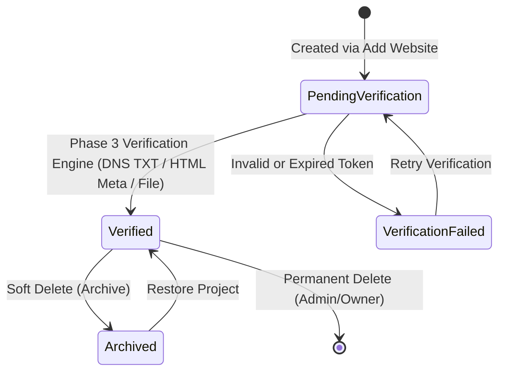

# RankForge AI — Website Projects & Domain Management

## 1. Overview
Websites are the primary target entities for technical SEO analysis, crawl discovery, metadata evaluation, and performance monitoring. Every website belongs to a tenant organization and is governed by strict domain validation and tenant isolation.

## 2. Project Lifecycle & Verification State Machine

In **Phase 2**, all newly created website projects are assigned `verification_status: "pending"` and `is_verified: false`.
Automated live crawling and ownership verification execution will occur in Phase 3.

## 3. Domain Normalization & SSRF Protection (`DomainNormalizer`)
Users can input various URL formats (`example.com`, `http://example.com`, `https://www.example.com/blog?tag=seo#hero`). The normalizer sanitizes input and enforces safety rules:

### Normalization Logic:
1. Strips path, query parameters, fragments, userinfo, and trailing slashes.
2. Lowers casing across hostnames.
3. Automatically sets canonical protocol (defaulting to `https://`).
4. Generates two fields:
   - `domain`: `example.com`
   - `primary_url`: `https://example.com/`

### Security Guardrails:
- **Control Character Rejection**: Rejects ASCII < 32 or 127.
- **Embedded Credentials Block**: Rejects `user:pass@host` format.
- **Port Restriction**: Restricts allowed ports to standard web ports (80, 443, 8080, 8443).
- **SSRF Blocklist**:
  - `127.0.0.1`, `localhost`, `0.0.0.0`, `::1`
  - `169.254.169.254` (AWS/GCP/Azure link-local cloud metadata)
  - RFC 1918 Private IP ranges (`10.0.0.0/8`, `172.16.0.0/12`, `192.168.0.0/16`)
  - Loopback, multicast, link-local, and reserved IPv4/IPv6 ranges
  - Blocked internal TLDs: `.local`, `.internal`, `.lan`, `.corp`, `.test`, `.invalid`

## 4. Ownership Verification Protocols (Prepared for Phase 3)
During project creation, a cryptographically random verification token is generated: `rankforge-site-verification=<32_hex_chars>`.

Three verification methods are provisioned:
1. **DNS TXT Record**: Root domain TXT record containing the token.
2. **HTML Meta Tag**: `<meta name="rankforge-site-verification" content="<token>" />`.
3. **File Upload**: Hosted static text file at `/<token>.txt`.
